<div align="center">

<!-- Hero Banner (Self-hosted SVG) -->
<a href="https://abhinavkumar-dev.vercel.app/">
  
</a>

<br/><br/>

<!-- Status and Quick Nav Pills -->
[](https://abhinavkumar-dev.vercel.app/)
[](https://www.linkedin.com/in/pathiabhinavkumar/)
[](https://leetcode.com/u/abhinavkumar_15/)
[](mailto:pathiabhinavkumar@gmail.com)

<br/>

> *“The most compelling opportunities in artificial intelligence do not lie in generic software, but in extracting clean signal from complex, high-dimensional empirical data.”*

<br/>

</div>


## ◈ 01 / Profile Dossier & Trajectory

I am an undergraduate specializing in **Artificial Intelligence and Machine Learning** at **Sreyas Institute of Engineering and Technology, Hyderabad (2024 – 2028)**. 

My work focuses on designing predictive architectures, synthesizing high-dimensional datasets, and operating at the intersection where computational intelligence informs biological inquiry and analytical decision systems.

```yaml
identity:
  name: "Abhinav Kumar"
  focus_areas:
    - "AI & ML"
    - "Deep Learning"
    - "Bioinformatics"
    - "Data Analytics"
  education: "B.Tech in CSE (AI/ML) · Sreyas Institute, Hyderabad [2024 — 2028]"
  location: "Hyderabad, Telangana, India [GMT +5:30]"
  current_status: "Undergraduate Researcher & Engineer"
  open_to:
    - "AI/ML & Data Analytics Internships & Roles"
    - "Computational Biology & Healthcare AI Research"
    - "Freelance Architecture & Collaboration"
  philosophy: "Teaching machines to think. Teaching data to talk. Trying to figure out life's source code."
```


## ◈ 02 / Technical Competencies

<table>
  <tr>
    <td width="30%" valign="top"><b>01 / AI & Machine Learning</b><br/><i>Predictive algorithms, validation & interpretability</i></td>
    <td width="70%">
      
      
      
      
      
    </td>
  </tr>
  <tr>
    <td width="30%" valign="top"><b>02 / Deep Learning</b><br/><i>Neural architectures & multi-horizon forecasting</i></td>
    <td width="70%">
      
      
      
      
    </td>
  </tr>
  <tr>
    <td width="30%" valign="top"><b>03 / Bioinformatics</b><br/><i>Computational biology & healthcare prognostics</i></td>
    <td width="70%">
      
      
      
      
    </td>
  </tr>
  <tr>
    <td width="30%" valign="top"><b>04 / Data Analytics</b><br/><i>Statistical synthesis, data modeling & EDA</i></td>
    <td width="70%">
      
      
      
      
      
      
    </td>
  </tr>
  <tr>
    <td width="30%" valign="top"><b>Cloud & Data Infrastructure</b><br/><i>Relational databases, indexing & cloud telemetry</i></td>
    <td width="70%">
      
      
      
      
      
    </td>
  </tr>
</table>


## ◈ 03 / Featured Systems & Case Studies

<table>
  <tr>
    <td width="50%" valign="top">
      <h3>⚡ VoltGuard AI — EV Battery Health & RUL Prognostics</h3>
      <p><i>Deep Learning · Predictive Diagnostics · Multi-Horizon Modeling</i></p>
      <ul>
        <li>End-to-end machine learning framework predicting EV battery <b>State of Health (SOH)</b> and <b>Remaining Useful Life (RUL)</b>.</li>
        <li>Trained on empirical cycler aging telemetry with rigorous <b>Leave-One-Battery-Out (LOBO) cross-validation</b>, forecasting degradation 5 to 50 cycles into the future.</li>
        <li>Integrated <b>SHAP explainability</b> with an interactive FastAPI backend and dynamic telemetry dashboard.</li>
      </ul>
      <p>
        <code>Python</code> · <code>Scikit-learn</code> · <code>FastAPI</code> · <code>React</code> · <code>SHAP</code> · <code>Tailwind CSS</code>
      </p>
      <p>
        <a href="https://github.com/abhinavkumar-15/ev-battery-degradation"><b>[ Source Code ]</b></a> &nbsp;·&nbsp;
        <a href="https://ev-battery-degradation.vercel.app"><b>[ Live Deployment ↗ ]</b></a>
      </p>
    </td>
    <td width="50%" valign="top">
      <h3>🌐 Smart Grid Energy Distribution System</h3>
      <p><i>AI & Machine Learning · Graph Optimization · Infrastructure</i></p>
      <ul>
        <li>Modeled complex electrical transmission topologies with <b>NetworkX</b>, dynamically balancing load across generation buses, substations, and critical priority infrastructure.</li>
        <li>Applied constrained shortest-path and resistive loss minimization algorithms, cutting peak transmission losses by <b>~18%</b>.</li>
        <li>Visualized automated fault rerouting and power flows with Matplotlib graph analytics.</li>
      </ul>
      <p>
        <code>Python</code> · <code>NetworkX</code> · <code>Matplotlib</code> · <code>Graph Analytics</code>
      </p>
      <p>
        <a href="https://github.com/abhinavkumar-15/Smart-Grid-Energy-DIstribution-System"><b>[ Source Code ]</b></a>
      </p>
    </td>
  </tr>
  <tr>
    <td colspan="2" valign="top">
      <h3>❦ Thryve — Digital Publishing Platform for Self-Authored Essays</h3>
      <p><i>Web Architecture · Firebase · Creative Philosophy · Content Indexing</i></p>
      <ul>
        <li>Engineered a custom editorial publishing platform on Firebase featuring dedicated reader/author workspaces, real-time search, and dynamic multi-tag filtering (<code>#PURPOSE</code>, <code>#THOUGHT</code>, <code>#MORALS</code>, <code>#LOVE</code>, <code>#GROWTH</code>).</li>
        <li>Serves as the home for my self-authored reflective essays exploring consciousness, human circumstances, and evolutionary rhetoric (including <i>Searching The Soul</i>, <i>For The Love Of Love</i>, and <i>As Good As The Old</i>).</li>
      </ul>
      <p>
        <code>Web Architecture</code> · <code>Firebase</code> · <code>Reader Workspaces</code> · <code>Content Indexing</code> · <code>Creative Writing</code>
      </p>
      <p>
        <a href="https://thryve-blog.web.app/"><b>[ Explore Live Platform ↗ ]</b></a>
      </p>
    </td>
  </tr>
</table>


## ◈ 04 / Experience, Research & Milestones

- **Cloud & Data Intern** — `Core Defender AI` *(June 2026 – August 2026)*
  - Contributed to data ingestion pipelines and cloud infrastructure for a Wearable Devices Platform.
  - Architected relational schemas, fine-tuned indexing, and verified PostgreSQL migrations for high-throughput streaming on **AWS RDS**, **Aurora PostgreSQL**, **Amazon CloudWatch**, and **Amazon SNS**.

- **Robotics & Autonomous Pipelines Intern (Exploratory)** — `Yotzeron` *(July 2026 – October 2026)*
  - Completed an exploratory engineering practicum testing sensor telemetry, spatial mapping, and simulation pipelines with **ROS 2**, **Gazebo**, and **SLAM** to understand physical system constraints.

- **Scopus Research Publication (In Pipeline)** — `IJEM` *(2026)*
  - Primary author for machine learning research paper accepted / in pipeline at the *International Journal of Engineering Management*.

- **Student Honour — Green Growth Economic Summit 2026** *(HICC, Hyderabad)*
  - Conferred student honour for inter-collegiate leadership, sustainability dialogue, and engagement recognized by international delegates.

- **Ideathon Winner — StockPro**
  - Led team to 1st place victory for designing the financial market telemetry and analytics architecture.

- **Certification in Modern AI** — `Cisco Learning Academy` *(February 2026)*
  - Completed certification covering contemporary AI paradigms and algorithmic reasoning.

- **Leadership & Campus Initiatives**
  - Event Manager for the flagship **Sreyas Developers Conference**; Core organizing member for campus-wide **TEDx** conferences.


## ◈ 05 / Beyond The Terminal

Outside the codebase, personal discipline and artistic traditions shape how I approach algorithmic problems:

* **🏓 Athletics & Table Tennis**: Competitive table tennis player with college tournament podium finishes, cultivating microsecond reflexes and strategic composure under pressure. An ardent lawn tennis follower inspired by Novak Djokovic's baseline precision and mental endurance.
* **🪕 Indian Classical Music & Sitar**: Deep admirer of the sitar and heritage Indian classical traditions. The intricate, meditative mathematics of classical ragas instills patience, nuance, and harmonic structure in complex engineering work.
* **✍️ Reflective Writing**: Authoring philosophical prose on [Thryve](https://thryve-blog.web.app/), seeking clarity on human purpose and societal evolution.


## ◈ 06 / GitHub Telemetry & Activity

<div align="center">
  <table border="0">
    <tr>
      <td align="center">
        
      </td>
      <td align="center">
        
      </td>
    </tr>
  </table>
  
  <br/>
  
  
</div>


## ◈ 07 / Get in Touch & Correspondence

Whether you're looking to discuss AI/ML & Data Analytics engineering roles, computational biology research collaborations, or system architecture inquiries:

<div align="center">

<a href="mailto:pathiabhinavkumar@gmail.com">
  
</a>
&nbsp;
<a href="mailto:abhinavkumar4902@gmail.com">
  
</a>

<br/><br/>

[](https://abhinavkumar-dev.vercel.app/)
[](https://github.com/abhinavkumar-15)
[](https://www.linkedin.com/in/pathiabhinavkumar/)
[](https://leetcode.com/u/abhinavkumar_15/)

<br/>

<sub>© 2026 Abhinav Kumar · Designed with restraint & editorial care.</sub>

</div>
